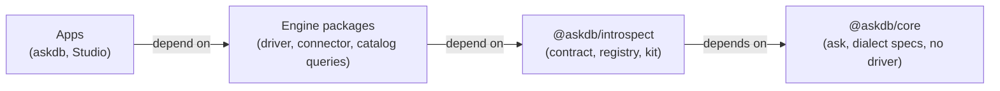

# ADR 0002: One package per integration surface

**Status:** accepted · 2026-05-10

## Decision

AskDB has one package for each integration surface, not one for each layer.

| Package | Owns | Never holds |
|---|---|---|
| `@askdb/core` | The `ask()` pipeline, the schema types, modes, logging and the built-in dialect specs (ADR 0029) | A database driver, a connection, or code that runs generated SQL |
| `@askdb/introspect` | The `Connector<TInput>` contract, the orchestrator, the Schema v2 renderer, the connector registry and the engine kit (ADR 0008) | A default connector, an engine's input type, a driver |
| An engine package (`@askdb/postgres`, `@askdb/prisma` and the others) | Its driver, its connector, its connector input type and its catalog queries | Nothing of another engine |

`ask()` takes a `dialect` and returns SQL. It has no option for a connection or an executor. Each engine defines its own connector input, and a connector's SQL templates are optional.

The packages under `apps/` are first-party products, not extension points. `askdb introspect` is the one command that introspects.

## Why

- A Prisma schema file and a live Postgres catalog are different kinds of input. One shared input type forces each new integration to pretend that it fits.
- A host installs only the driver it uses. `@askdb/core` installs with no database dependency.
- A new engine is a new package, with no change to `@askdb/introspect`. A new built-in dialect also adds its spec to core (ADR 0029).

## Options

| | Option | Why it lost |
|---|---|---|
| A | One package for each integration surface | **Chosen.** |
| B | Keep the Postgres code in core, behind a `@askdb/core/postgres` subpath | Postgres code had spread into core and `@askdb/introspect`, and each new engine would spread the same way. |
| C | One `live` or `from-export` input type in `@askdb/introspect` | Prisma has no live connection and no catalog templates, so it does not fit. |
| D | Each engine package owns its SQL dialect | `ask()` must work with only core installed, and every engine package depends on core (ADR 0029). |

## Keep

| Rule | Checked by |
|---|---|
| `@askdb/core` imports no database driver and no engine package. | review |
| `ask()` has no option that takes a connection or runs SQL. | review |
| `@askdb/introspect` has no default connector: `introspect()` uses the connector that its caller passes. | `packages/introspect/src/introspect.test.ts` |
| `@askdb/introspect` names three source kinds (`url`, `fromExport`, `schemaPath`) and no engine's input type. | review |

Dialect rules are ADR 0029's. The registry and the engine kit are ADR 0008's.
