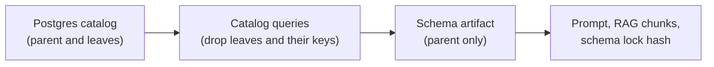

# ADR 0003: Postgres partition leaves are filtered out; the parent is the table

**Status:** accepted · 2026-05-12

## Decision

The catalog queries in `@askdb/postgres` leave out every leaf of a declaratively partitioned table, at any depth. The partitioned parent is the one table in the schema artifact.

The same filter drops a foreign key when either side of it is a partition leaf. So every relationship points at a table that the artifact contains.

A child of plain `INHERITS` is not a partition. It stays a table.

## Why

- A leaf and a plain table have the same `relkind`. Only `pg_inherits` tells them apart, and only the catalog read can see it.
- One table with 64 monthly partitions appeared 65 times. The copies crowded the parent out of prompts and retrieval.
- Postgres clones a foreign key onto each partition. Without the filter, the clones point at tables that the artifact left out.
- A filter at the catalog read covers every consumer. No consumer can forget it.

## Options

| | Option | Why it lost |
|---|---|---|
| A | Filter in the catalog queries | **Chosen.** |
| B | Carry a partition flag and the parent through the schema model, and let each consumer decide | It changes the Schema v2 contract for a Postgres-only concept that no product surface reads, and each consumer must remember to filter. |
| C | Filter in the RAG chunker, by table name | A name is not a reliable signal, and the leaves still reach the artifact, the prompt and the lock hash. |
| D | Drop cloned foreign keys with `conparentid = 0` | The column does not exist before PostgreSQL 11, and it does not guarantee that a key's target is in the artifact. |

## Keep

| Rule | Checked by |
|---|---|
| A leaf of a declaratively partitioned table is never a table in the artifact. Its parent is. | `packages/postgres/src/connector/partition-fk.integration.test.ts`, `packages/postgres/src/connector/multi-engine.integration.test.ts` |
| A foreign key to or from a partition leaf is dropped. The key between the canonical tables stays. | `packages/postgres/src/connector/partition-fk.integration.test.ts` |
| A plain `INHERITS` child stays a table. | review |
| The schema model holds no partition field. A change here needs a new ADR. | review |
