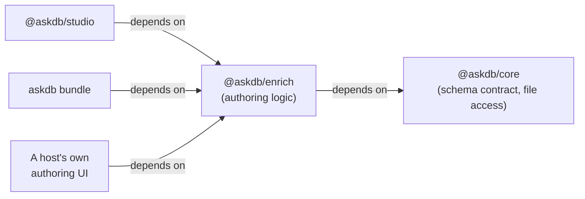

# ADR 0004: `@askdb/enrich` is the headless authoring layer

**Status:** accepted · 2026-05-12

## Decision

`@askdb/enrich` holds the authoring logic for a schema directory, and it has no UI. It loads a workspace, builds table drafts, and saves table, concept and tenant-policy files. It also builds the context for AI suggestions and bundles a directory into one JSON artifact.

Studio and `askdb bundle` call it. A host can build its own authoring UI on it.

`@askdb/enrich` depends on `@askdb/core` only. Core holds the schema contract and the rules for file access to a schema directory (ADRs 0027, 0028). Core holds no authoring workflow.

## Why

- A second authoring UI needed the logic that the first one held. To reuse it, one UI package had to depend on the other.
- Authoring is a workflow over files. It is not part of the schema contract or of NL-to-SQL, so it stays out of core.
- Two copies of the file-access rules drifted apart and failed open. Those rules now have one owner: core.

## Options

| | Option | Why it lost |
|---|---|---|
| A | A separate headless package between core and the UIs | **Chosen.** |
| B | Keep the logic in a UI package | Every other surface then depends on that UI's dependencies, and one package is both an app and a shared library. |
| C | Move the logic into core | It is an authoring workflow, not the schema or NL-to-SQL contract, and core must stay small. |

## Keep

| Rule | Checked by |
|---|---|
| Authoring logic lives in `@askdb/enrich`. Studio and the CLI do not copy it. | review |
| `@askdb/enrich` depends on `@askdb/core` and on no app or UI package. | review |
| A save from `@askdb/enrich` into a schema directory goes through core's `saveSchemaFile()`. | `packages/enrich/src/workspace.test.ts` |
| `bundleSchemaDirectory()` refuses each directory that core's loader refuses. | `packages/enrich/src/workspace.test.ts` |
| Core holds no authoring workflow. | review |
