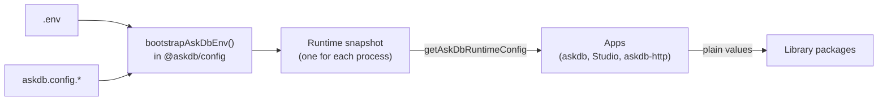

# ADR 0005: `@askdb/config` loads `.env` and `askdb.config.*` into one snapshot

**Status:** accepted · 2026-05-13

## Decision

`@askdb/config` loads `.env`, then `askdb.config.*`, and installs one runtime snapshot in memory. It does not copy the config into `process.env`. Every setting comes from the config file, and the file reads a variable with `env("NAME")`.

Only `@askdb/config` reads `process.env`. A first-party app calls `bootstrapAskDbEnv()` once and then reads `getAskDbRuntimeConfig()`. A library package does neither: it takes plain values from its host.

| Part | What holds |
|---|---|
| Config file | `askdb.config.*`, or `.config/askdb.*` beside a Prisma config. The default export is `defineConfig({ … })` or a plain object. `ai` and `introspection` are required. |
| Snapshot | One for each process. Every copy of `@askdb/config` in the process shares it. |
| `createAskDbHttpServer()` | It uses the host's snapshot. With none, it bootstraps from the working directory when it is built. |
| AI settings | The snapshot carries typed sections, and `@askdb/ai` takes a section as it is. Neither package depends on the other. |
| A new project's files | `@askdb/config/scaffold` plans them. `askdb init` and Studio's setup wizard both call it. |
| Exceptions | `ASKDB_DEBUG`, which `@askdb/config` reads itself, and the base URL check of ADR 0036. |

## Why

- A library that reads `process.env` depends on a hidden step: some code must load `.env` first. One reader makes that step explicit.
- Users want their own variable names in `.env`. A config file maps them, as Prisma's does, and no library needs a second config object.
- A nested, typed config groups the AI, database, introspection and RAG settings. A flat map of variable names does not.

## Options

| | Option | Why it lost |
|---|---|---|
| A | One package loads a config file into a snapshot, and only it reads `process.env` | **Chosen.** |
| B | Each package reads fixed variable names from `process.env` | The load order is a hidden dependency, users cannot keep their own names, and a flat list has no groups. |
| C | The loader accepts only `defineConfig({ … })` | The plain object, the simplest form in the guides, then fails to load. |
| D | Make the `ai` block optional for a host that never generates SQL | The runtime's AI section becomes optional, a public type change for every host that reads it. |
| E | The HTTP server factory leaves the bootstrap to the host | The documented four-line example fails every request when the host omits the call. |
| F | The HTTP server bootstraps on the first request | A missing config shows only as a `500`, while `/health` stays green. |
| G | Make `@askdb/config` a peer of `@askdb/http-api`, so a process has one copy | The apps are batteries-included and keep their runtime dependencies direct (ADR 0006). The copies share the snapshot instead. |
| H | `@askdb/config` writes each AI section as the variable names each provider reads | Each provider's mapping then exists twice, and only a test holds the copies in step. |
| I | Each app keeps its own project templates, with a test that compares them | The per-engine switches stay in the apps (ADR 0007), and the copies had already drifted. |
| J | Put the project scaffold in `@askdb/ai` | It owns provider facts, not the shape of the config file, and it has no dependency on `@askdb/config`. |
| K | Load every config file through jiti | jiti cannot start inside an app's bundle, so a bundled host loaded no config. A JavaScript config loads with Node's own loader. |
| L | A public way for a host to install a config object that it imports itself | It is a new public API, and a one-way decision before 1.0. |
| M | `askdb-http` reads a `.env` in `node_modules` last | It still reads settings from a folder that the host does not own. |

## Keep

| Rule | Checked by |
|---|---|
| Only `@askdb/config` reads `process.env`. ADR 0036's check in `@askdb/ai` is the one exception. | review |
| An app reads settings through `getAskDbRuntimeConfig()`. A library package takes them from its host. | review |
| Help text names config keys, never a variable that AskDB does not read. | `apps/cli/src/spawn-help.test.ts` |
| `ASKDB_DEBUG` is the one AskDB variable read from the environment, and it works when the config fails to load. | `apps/cli/src/spawn-first-run.test.ts` |
| `createAskDbHttpServer()` never loads a config over a host's snapshot, even when the host has its own copy of `@askdb/config`. With no config, it throws when it is built. | `apps/http-api/src/server.bootstrap.test.ts` |
| A copy of `@askdb/config` reads a shared snapshot from its structured config, never from another copy's flat map. A shape that older copies cannot read needs a new key. | `packages/config/src/config.test.ts` |
| A plain-object config gets the same checks as `defineConfig`. A config with no `ai` or no `introspection` block fails, and the error names the block. | `packages/config/src/config.test.ts` |
| A JavaScript config loads without jiti. | `packages/config/src/load-js-config.test.ts` |
| A typed AI section and the matching variable map give the same `AiConfig`, for every provider. | `packages/client/src/provider-config-drift.test.ts` |
| `@askdb/config` and `@askdb/ai` do not depend on each other. | review |
| Studio's setup wizard offers exactly the engines and stores that the scaffold planner writes. Neither app keeps its own project templates. | `apps/studio/src/setup-engines.test.ts`, review |
| `askdb-http` tries the working directory's `.env` first, and never one inside `node_modules`. | `apps/http-api/src/dotenv-candidates.test.ts` |
| `askdb init` runs without a config file. | review |
| `@askdb/config/scaffold` stays an experimental entry point (ADR 0030). | review |

The config keys and the loader's rules are in the docs site's config reference.
