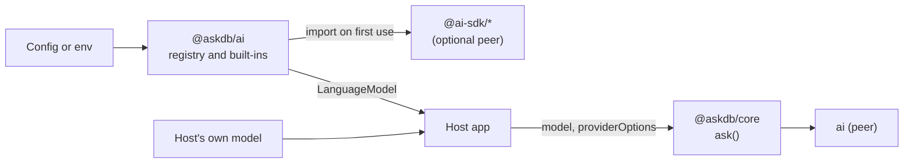

# ADR 0006: Core is BYO-model; `@askdb/ai` owns the provider registry

**Status:** accepted · 2026-06-11

## Decision

`ask()` takes an AI SDK `LanguageModel` that the caller builds. `@askdb/core` builds no model, reads no provider config and depends on no provider SDK. It passes the model and an opaque `providerOptions` bag to the AI SDK, and it reads neither.

`@askdb/ai` is the optional path from config or env to a model. It holds one registry and one table of built-in providers, with one file for each provider. A built-in that needs an `@ai-sdk/*` package imports it the first time it builds a model. A host adds any other provider as an `AiProviderAdapter`.

A library package declares what a host can already have installed as a peer:

| Package | `ai` | `@ai-sdk/*` provider SDKs |
|---|---|---|
| `@askdb/core` | Required peer, AI SDK 6 and 7 | None |
| A library package that depends on core | Peer, with core's range | None |
| `@askdb/ai`, `@askdb/client` | Required peer, AI SDK 7 | Optional peers, with the floors of ADR 0015 |
| The apps (`askdb`, `@askdb/http-api`, `@askdb/studio`) | Dependency, with `zod` | Dependencies: the apps are products |

## Why

- The host and core must share one `ai` instance, because the host builds the model. A bundled `ai` forces the host's AI stack to AskDB's major, or installs a second copy.
- One package for each provider saved nothing. The apps loaded every provider, a host needed two installs to use one, and the provider list drifted across nine places.
- A reasoning setting maps to options that differ by provider and by model. That knowledge belongs in the provider's file, so core only forwards the bag.

## Options

| | Option | Why it lost |
|---|---|---|
| A | Core takes a `LanguageModel`; one `@askdb/ai` holds the registry and the built-in providers, loaded on first use | **Chosen.** |
| B | Keep provider construction in core | Every core consumer installs every provider SDK, and a new provider changes core. |
| C | BYO model only, with no helper package | The apps and each config-driven host would copy the same provider wiring. |
| D | Core builds the model from provider config | It removes custom models, proxies and test models, and it puts bootstrap code in core. |
| E | An AskDB-owned inference interface in place of `LanguageModel` | It copies the AI SDK's contract, and a host with an AI SDK model then needs an adapter. |
| F | One package for each provider (`@askdb/ai-openai` and the others) | The apps still loaded every SDK, a host needed two installs for one provider, and the lists drifted. |
| G | One subpath entry for each provider (`@askdb/ai/openai`), with a static import | It loses selection by provider name with no arguments. A webpack 5 host lists the missing SDKs in `externals` instead. |
| H | `ai` as a dependency of core | A host on another AI SDK major gets two copies of `ai` whose types disagree. |
| I | `ai` as an optional peer of core, imported on first use | Core's published types still import `ai`, so a consumer without it gets type errors or `any`. |
| J | Tell Yarn Plug'n'Play users to change their linker, with no pass-through peers | `yarn dlx askdb` has no project to configure. |

## Keep

| Rule | Checked by |
|---|---|
| `@askdb/core` depends on no `@ai-sdk/*` package and not on `@askdb/ai`. It re-exports nothing from `@askdb/ai`. | review |
| Core sends the system prompt in a form that AI SDK 6 and AI SDK 7 both read. | `packages/core/src/sql/generate.test.ts`, `packages/core/src/enrichment/suggest.test.ts`, `examples/installable-smoke/run.sh` |
| Core forwards `providerOptions` unchanged, and sends none when the caller gives none. | `packages/core/src/sql/generate.test.ts` |
| Docs and examples treat a built-in provider and a raw `LanguageModel` as equal first-party paths. | review |
| Each built-in that needs an SDK writes its own `import()` of it, with the `.catch()` chained on it. A missing SDK fails when the provider first builds a model, with the install message. | `packages/ai/src/providers/optional-peer.test.ts`, `examples/installable-smoke/run.sh` |
| `@askdb/ai` works at the floor of each `ai` and `@ai-sdk/*` peer range. | `scripts/test-ai-sdk-floors.sh` |
| A library package never bundles `ai`, a provider SDK or a database driver as a dependency. | review |
| A package that depends on core declares `ai`. A package that depends on `ai` or an `@ai-sdk/*` package provides `zod`. | `examples/installable-smoke/yarn-pnp.sh` |
| `@askdb/config` and `@askdb/ai` never depend on each other. The provider list and default models that `@askdb/config` keeps agree with the `@askdb/ai` table. | `packages/client/src/provider-config-drift.test.ts` |
| `AiProviderAdapter` stays the public extension point. A custom adapter registers beside a built-in, or in place of one. | `packages/ai/src/registry.test.ts` |
| The built-in table holds only the providers that AskDB ships and tests. | review |

ADR 0015 holds the rule for when a peer floor rises.
