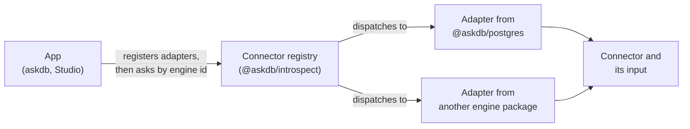

# ADR 0007: Apps dispatch through the connector registry

**Status:** accepted · 2026-06-11

## Decision

Each engine package exports one connector adapter, a `ConnectorProviderAdapter`. A host passes the adapters it supports to `createConnectorRegistry()`. The CLI and Studio choose a connector and resolve a connection through that registry. Neither app holds a per-engine switch for this.

The registry depends on no engine package. A host installs and registers only the engines it uses, and no adapter registers itself. An adapter can offer an optional capability, such as its SQL templates. A caller then asks the registry and needs no engine import.

The registry lives in `@askdb/introspect`, takes open provider ids, and can load a registered adapter on first use (ADR 0008). A connector serves introspection only: it never runs generated SQL.

## Why

- Without a registry, each app imports every engine package and writes the same switch again.
- The same split already works for AI providers (ADR 0006). One package owns the contract, and each integration owns its adapter.
- A registry with no engine dependency keeps an install small. A host that uses only Postgres installs no other engine.

## Options

| | Option | Why it lost |
|---|---|---|
| A | A registry, with one adapter exported by each engine package | **Chosen.** |
| B | Each app switches on the engine name | Every consumer imports all engine packages and repeats the dispatch. |
| C | A registry that depends on the engine packages | Every host then installs every engine. |

## Keep

| Rule | Checked by |
|---|---|
| The CLI dispatches through the registry: an adapter for a third-party engine works with no change to the app. | `apps/cli/src/introspect-registry.test.ts` |
| The CLI and Studio hold no per-engine switch for the connector or the connection. | review |
| The registry dispatches by provider id to the adapter that the host registered. For an id with no adapter, it names the package to install. | `packages/introspect/src/registry.test.ts` |
| The package that holds the registry depends on no engine package. | review |
| A host registers each adapter. No adapter registers itself. | review |
| An engine package keeps its direct connector factory beside its adapter. | review |

A new engine needs no change to the registry. A new built-in dialect also adds its spec to core (ADR 0029).
