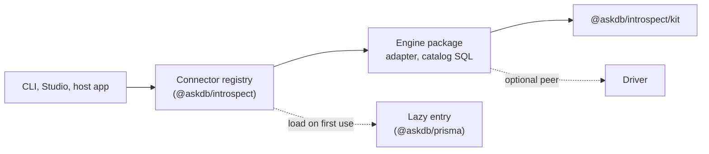

# ADR 0008: One package per engine; shared mechanics in `@askdb/introspect/kit`

**Status:** accepted · 2026-09-25

## Decision

Each database engine keeps its own package. The package owns the engine's catalog SQL, its optional driver peer, its connection formats and its connector provider adapter. ADR 0029 puts the dialect specs in core.

The mechanics that no engine owns live once, in `@askdb/introspect/kit`: driver loading, table filters, ids, row folding, connection labels and the adapter for live-only engines. The kit is a set of plain functions, not a base class.

`@askdb/introspect` owns the connector registry, and the rules of the registry are:

- **Provider ids are open.** Any string is a valid id, so a third-party engine registers without a change to AskDB.
- **The adapter resolves the connection.** It turns explicit values and runtime config into one of three source kinds: `url`, `fromExport` or `schemaPath`. The registry builds the label (ADR 0011).
- **An entry can be lazy.** The registry lists a lazy entry by its id and imports its package on the first `registry.load()`.

## Why

- The engine packages had grown by copy, to about 700 duplicated lines. A fix to driver errors, filters or labels reached one engine at a time.
- A closed provider union, and an engine switch in the CLI and in Studio, stopped a third-party engine. Which config value is the connection is engine knowledge, like catalog SQL.
- An optional engine package cannot be imported at startup. As a dependency, `@askdb/prisma` made `pnpm add askdb` fail on pnpm 11 for every user.

## Options

| | Option | Why it lost |
|---|---|---|
| A | One package per engine, a shared kit, and an open registry in `@askdb/introspect` with lazy entries | **Chosen.** |
| B | Keep the registry in its own package (`@askdb/connectors`) and open its ids there | Every engine and app installs and versions a second package that hides nothing: each engine already depends on `@askdb/introspect`. |
| C | Keep connection resolution in the apps, with a table of rows for each engine | That table is the engine switch that ADR 0007 forbids, and a third-party engine cannot add its row. |
| D | Let the adapter return the label text | It makes the label allowlist optional, which ADR 0011 rejects. |
| E | A connection type that each engine defines | A host can supply only a URL, an export bundle or a schema path, so the CLI and Studio have nothing more to fill in. |
| F | Make every registry method async, for lazy entries | It breaks every host and docs example for a laziness that one entry needs. |
| G | A Prisma branch in the CLI, outside the registry | It is an engine switch in an app, and Studio would diverge. |
| H | Keep `@askdb/prisma` a dependency of the apps | Every pnpm 11 user approves a build, and installs Prisma, for an engine most do not use. |
| I | Check for an installed package through Node's resolver, or in a child process | Node 24 and later can keep a failed lookup until the process exits. A child process costs a spawn for each check, and the host's own load still misses. |

## Keep

| Rule | Checked by |
|---|---|
| An engine package never copies a kit helper. | review |
| Each engine writes its driver's `import()` in its own package, with the `.catch()` chained on it. A bundle then builds without the driver. | `examples/installable-smoke/run.sh` |
| A check for an installed package reads `node_modules` on disk, never Node's resolver. Yarn Plug'n'Play has no `node_modules`, so there the check asks the resolver. | `packages/introspect/src/kit/driver.test.ts` |
| A long-running host loads a driver that a user installs after a failed load, with no restart. | `packages/introspect/src/kit/driver.test.ts` |
| The CLI and Studio hold no engine switch. They dispatch through the registry, and the CLI's introspect command accepts an injected registry. | `apps/cli/src/introspect-registry.test.ts` for the CLI; review for Studio |
| A custom provider id registers and dispatches. An id with no adapter gets an install hint. | `packages/introspect/src/registry.test.ts` |
| The registry builds the label from the adapter's parts. An adapter never returns label text. | `packages/introspect/src/registry.test.ts` |
| An adapter's connection error never contains the connection string. | review |
| The registry lists a lazy entry without loading it. Until `registry.load()`, every other method throws for that entry, with no fallback answer. | `packages/introspect/src/registry.test.ts` |
| A failed load reaches the caller unchanged, and the next call tries again. | `packages/introspect/src/registry.test.ts` |
| `askdb --help` resolves no Prisma module. | `apps/cli/src/load-cost.test.ts` |
| The kit and the adapters read no `process.env` (ADR 0005). | review |
| The apps load only the adapters that their own code registers. They discover no third-party adapter. | review |
