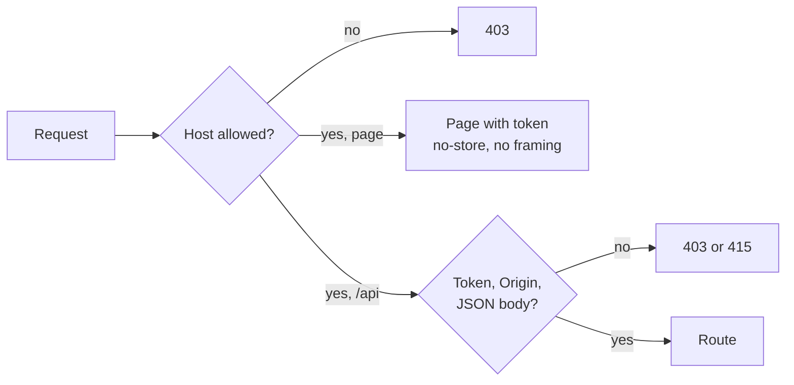

# ADR 0009: Studio's local API: Host allowlist, same-origin checks, a per-launch token

**Status:** accepted · 2026-09-25

## Decision

One request guard (`apps/studio/src/request-guard.ts`) runs before every Studio route:

| Check | Applies to | Stops |
|---|---|---|
| Host allowlist: a loopback name or the listen host, with the port the connection arrived on | Every request, the page and its assets included | DNS rebinding, and a rebound page that reads the token |
| Same-origin `Origin` | Each `/api/*` request that changes state | A write from another site |
| `Content-Type: application/json` | Each `/api/*` request with a body | A cross-site request that needs no CORS preflight |
| Session token: random for each launch, written into the page, sent back in a request header | Every `/api/*` request | A request that does not come from Studio's own page |
| `no-store` and frame denial | The served page | A stale token in a cache, and clickjacking |

Studio also binds to loopback by default and warns on any other bind. Setup, resync and driver install answer loopback clients only.

The token proves that a request comes from Studio's own page. It does not prove who the user is: anyone who can load the page gets the token.

## Why

- Studio's API runs SQL, writes the schema artifact, writes a config file that is later executed, and spends the developer's LLM key. A page in the developer's browser reaches it from `127.0.0.1`, so a check of the socket address stops nothing.
- The target is one developer on their own machine, with Studio on loopback and untrusted sites open in the same browser. Another site can send a request to Studio, but the same-origin policy and the Host check stop it from reading the page.
- A login token adds protection only against local users and processes. Those can already read the developer's files, which hold the same database and LLM credentials.

## Options

| | Option | Why it lost |
|---|---|---|
| A | A per-launch token in the page, with the Host, `Origin` and content-type checks | **Chosen.** |
| B | A login token in the launch URL, exchanged for an `HttpOnly` cookie (the Jupyter design) | A bookmark or a typed URL stops working, each restart needs a copy from the terminal, and the URL leaks into scrollback and history. Its added protection covers users who can already read the same credentials. |
| C | A `SameSite=Strict` cookie and no token | `SameSite` does not separate ports on one host, so another local web app on `localhost` counts as the same site. |
| D | The loopback bind and a check of the socket address only | A browser request from the developer's machine comes from `127.0.0.1`, so it stops neither attack. |
| E | A password, or OS-level authentication such as a Unix socket | It is out of proportion for a local authoring tool, and a browser cannot reach a Unix socket. |

## Keep

| Rule | Checked by |
|---|---|
| The Host check runs on every request, the page and static routes included. A wrong hostname or port gets `403`, and the reply never holds the token. | `apps/studio/src/server.test.ts`, `examples/consumer-lab/test/surfaces/studio.test.ts` |
| Every `/api/*` request needs the token. Each launch issues a new random token, and another launch's token is refused. | `apps/studio/src/server.test.ts`, `examples/consumer-lab/test/surfaces/studio.test.ts` |
| An `/api/*` write from another origin is refused, and so is a body that is not JSON. | `apps/studio/src/server.test.ts`, `examples/consumer-lab/test/surfaces/studio.test.ts` |
| The page forbids framing. | `apps/studio/src/server.test.ts` |
| The page is sent with `no-store`. | review |
| Setup, resync and driver install answer loopback clients only. | review |
| Studio binds to loopback by default, and warns at startup on any other bind. | review |
| The token proves same-origin, not identity. Docs never call it a login or authentication. | review |
| Studio's web UI renders no raw HTML: a script injected into the page can read the token. | review |
| Studio has no option that widens the Host allowlist. A shared machine, a bind for teammates, or a forwarded or proxied port needs a login token first, in a new ADR. | review |
