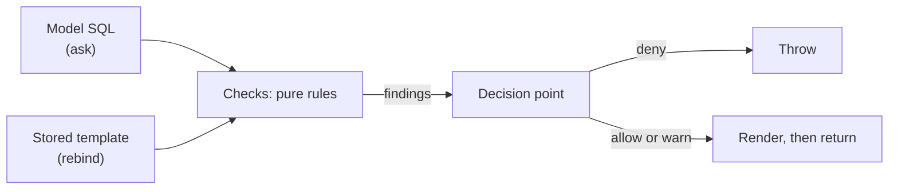

# ADR 0010: One decision point for SQL guardrails, enforced at return and at rebind

**Status:** accepted · 2026-10-07

## Decision

A check is a pure rule: it reads the model's SQL and returns findings. One decision point (`packages/core/src/sql/guardrail-decide.ts`) turns the findings and the modes into a verdict. `ask()` and `bindPreparedQuery()` act on that verdict.

The checks run on the model's SQL before AskDB renders it. A rebind runs the same checks again, under the schema and the tenant scope the host gives at bind time. No verdict is stored on a prepared query.

| Check | At return | At rebind |
|---|---|---|
| Read-only | Deny, always | Deny, always |
| Tenant | `strict`: deny. `warn`: warn | `strict`: deny. `warn`: deny, unless the caller accepts tenant warnings |
| Sensitive | `strict`: deny. `warn`: warn. `off`: not run | The same as at return |

## Why

- Each check had its own wiring, modes and result shape. That gave the same bug four times: a check ran on other SQL than the SQL returned, or one path skipped it.
- A host can store a prepared query and rebind it without a model call. A warning shown once at `ask()` would never show again.
- A check before rendering needs one tenant rule. A check after rendering needs one rule for each output mode and marker style.

## Options

How to stop a template that failed a check from running again:

| | Option | Why it lost |
|---|---|---|
| A | Check again at rebind, and store nothing | **Chosen.** |
| B | Store the verdict on the prepared query | A missing or old verdict must fail closed by rule. It needs the bind-time scope anyway, and the verdict becomes a stored format that hosts must migrate. |
| C | Store the verdict for display, and check again | It adds a stored format for display only. |
| D | Drop the reuse artifacts when a check warns | It enforces only at `ask()`. It misses a `global` template bound under another scope, and a policy that changed later. |
| E | Keep the wiring for each check | That structure made the bugs, and it grows with each check and mode. |
| F | A public plugin API for checks | Three checks do not justify a public extension point. |

## Keep

| Rule | Checked by |
|---|---|
| Only the decision point reads `strict`, `warn` and `off` for findings about SQL. ADR 0023's load-time policy check is the one other reader of a policy's `enforcement`. | review |
| Rendering changes only a placeholder and the comparison operator around it. | `packages/core/src/sql/checked-statement.test.ts` |
| A rebind runs the tenant and sensitive checks under the bind-time scope. It throws without the guardrail context. | `packages/core/src/sql/rebind.test.ts` |
| At rebind, tenant IDs come from the scope. A tenant value in `values` throws. | `packages/core/src/sql/rebind.test.ts` |
| A tenant `warn` is refused at rebind unless the caller accepts it. A sensitive `warn` is reported on every rebind. | `packages/core/src/sql/rebind.test.ts` |
| A tenant placeholder left in the SQL under a `global` scope throws, in `ask()` and at rebind. | `packages/core/src/sql/tenant-placeholders.test.ts`, `rebind.test.ts` |
| A `subtree` scope arrives at a rebind already expanded by core (ADR 0014). | `packages/core/src/sql/rebind.test.ts` |
| A custom `AskDialect` skips the read-only check. With a tenant policy and any scope but `global`, the tenant check still refuses a statement that is not a query, a function whose reads it cannot see, and the Postgres planner-statistics relations. A change here needs a new ADR. | `packages/core/src/sql/tenant-guardrail.test.ts` |
| Each path runs a fixed set of checks. `generateSelectSql()` runs no sensitive check, because it takes no sensitive mode. | `packages/core/src/sql/guardrails.test.ts` |
| The mechanical renderer stays below tenant substitution and the guardrails. | `packages/core/src/module-layering.test.ts` |
| A prepared query holds no verdict and stays at `version: 1`. | review |

The checks stay a lint, not a boundary (ADR 0012).
