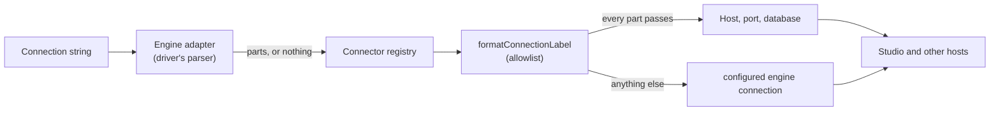

# ADR 0011: Connection labels are built from parsed parts

**Status:** accepted · 2026-09-29

## Decision

A connection label shows the host, the port and the database, or a file path. It never shows a user name. An engine's adapter returns those parts through its `connectionLabelParts` hook, and the connector registry builds every label from them.

The shared builder, `formatConnectionLabel` in `@askdb/introspect/kit`, checks each part against an allowlist. When the input does not parse cleanly, or a part fails the allowlist, the label is `configured <engine> connection`. No other text from the connection string reaches a label.

An engine takes the parts from the parser that its driver uses, so the label names what the connection uses. When the driver's parser cannot be a dependency, the engine mirrors it, and a differential test compares the two.

## Why

- Masking fails open. It copies all text that it does not recognise as a secret, so each new spelling of a secret leaked. Three reviews each found one.
- A second parser for a driver's grammar splits some strings differently from the driver. Part of a password is then read as the database or the server.
- A hook that returns label text makes the allowlist optional. A third-party adapter can then return the raw URL.

## Options

How to build the label:

| | Option | Why it lost |
|---|---|---|
| A | Build the label from parsed parts. Adapters return parts, and the registry formats them. | **Chosen.** |
| B | Mask each secret and keep the rest of the string | Masking fails open: a spelling it does not recognise is copied into the label. |
| C | Always show `configured <engine> connection` | The label exists to say which database Studio reads, and this text cannot tell staging from production. |
| D | Adapters return the label text | An adapter that skips the builder returns a raw or masked URL, and Studio must switch on the engine (ADR 0007 forbids that). |
| E | AskDB's own parser for each engine's formats | It split some strings differently from the driver, and it read part of a password as the database. |

How the Prisma `sqlserver://` form reads a `{…}` value. AskDB parses this form itself, because no driver reads it:

| | Option | Why it lost |
|---|---|---|
| A | Braces escape a value only when they wrap a `;` | **Chosen.** |
| B | Prisma's grammar for every `{…}` | It changes working strings that hold a literal brace, and an unclosed `{` would throw. |
| C | Braces are always literal | Prisma's own documented example, a braced password that holds a `;`, is cut at the `;`. |

## Keep

| Rule | Checked by |
|---|---|
| No label is built by masking or from a denylist of secret key names. This also holds for input that the parser does not handle. | review |
| Each input that leaked a secret through the earlier label code gives a label without the secret. | `packages/postgres/src/label.test.ts`, `packages/mysql/src/label.test.ts`, `packages/sqlserver/src/label.test.ts`, `packages/sqlite/src/label.test.ts` |
| An adapter returns parts, never label text. Unsafe parts, a wrong shape, or a hook that throws give the fallback label. | `packages/introspect/src/registry.test.ts` |
| The builder accepts a part only when it passes the allowlist. A looser allowlist needs a new ADR. | `packages/introspect/src/kit/label.test.ts` |
| Each part a label shows equals what the driver resolves from the same string. | `packages/postgres/src/label.test.ts`, `packages/mysql/src/label.test.ts`, `packages/sqlserver/src/label.test.ts` |
| A built-in engine does not write its own parser for a driver's grammar. It uses the driver's parser, or mirrors it with a differential test. | review |
| An engine's parser dependency keeps the version range that its driver declares, so a host resolves one copy. | review |
| A URL with an `@` or `#` after the host gets the fallback, because a password ended the host early. A new engine uses `parseConnectionUrl` or repeats this check. | `packages/introspect/src/kit/label.test.ts`, `packages/postgres/src/label.test.ts` |
| In the `sqlserver://` form, every string except a braced value that holds a `;` connects as it did before. `initial catalog` stays ignored. | `packages/sqlserver/src/exec/sqlserver.url.test.ts` |
| A `sqlserver://` string that has more than one reading gets the fallback label, even when it connects. | `packages/sqlserver/src/label.test.ts` |
| Studio serves the registry's label without a second pass. | `apps/studio/src/server.test.ts` |
| An app does not parse a connection string or switch on the engine. A new format goes into the engine package's parser. | review |
| An adapter's `error` text does not repeat the connection string. | review |

Some valid strings get the fallback label, such as a libpq keyword string or a SQL Server named instance. To show one, widen the allowlist or add a part. Do not add a parser.
