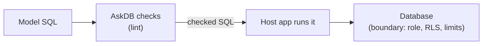

# ADR 0012: SQL checks are a lint; the database is the security boundary

**Status:** accepted · 2026-09-29

## Decision

AskDB's three SQL checks (read-only, tenant, sensitive) are a lint that catches common model mistakes. The database is the security and tenant boundary: a read-only role, row-level security, timeouts and row limits.

AskDB fails closed only for what it owns: a tenant scope is required, a `subtree` scope is expanded, and tenant IDs are bound without a change to the statement's structure.

When a check cannot read a form of SQL exactly as the engine reads it, the check refuses the form. It does not decode the form or copy the engine's rules.

## Why

- AskDB returns SQL and never runs it. It cannot see the role, the grants, row-level security, the views or the server's string settings.
- A boundary must read SQL exactly as each server and version reads it. The checks read tokens, not a parse tree.
- Each attempt to copy an engine's reading found a new difference in the next review. A refusal has no such list to extend.

## Options

| | Option | Why it lost |
|---|---|---|
| A | The checks are a lint, and the database is the boundary | **Chosen.** |
| B | Make the checks the boundary: a parser for each engine and a proof of tenant scoping | AskDB cannot see the server's modes, views and functions, and it would vouch for SQL that it does not run. |
| C | Drop the checks | Hosts lose cheap catches, and Studio's Execute uses the read-only check as one of its guards. |
| D | Decode or model a form the checks read differently from the engine (SQL Server tokens, Postgres `U&"…"` names, CockroachDB byte strings) | The copy never matched the engine: each review found another difference, and each difference was a new way past the checks. |

## Keep

| Rule | Checked by |
|---|---|
| Docs say "checks" and "checked SQL". They never call the checks a security boundary, and never promise tenant isolation or read-only execution. A change to this wording needs a new ADR and an update to `docs/contracts/tenant-policy.md`. | review |
| With a tenant policy, `ask()` throws without a valid tenant scope. | `packages/core/src/sql/tenant-scope-validate.test.ts` |
| A tenant placeholder that AskDB cannot bind throws. It is never returned raw. | `packages/core/src/sql/tenant-placeholders.test.ts` |
| An inlined tenant ID is printable ASCII with no backslash. Any other ID is refused, not escaped (ADR 0024). | `packages/core/src/sql/tenant-placeholders.test.ts` |
| A form a check cannot read as the engine does is refused, in all three checks. | `packages/core/src/sql/validate.test.ts`, `tenant-guardrail.test.ts`, `sensitive-guardrail.test.ts` |
| The `postgres` dialect is also read the CockroachDB way, because a host can point it at CockroachDB. | `packages/core/src/sql/validate.test.ts`, `tenant-guardrail.test.ts` |
| Known gaps stay listed in `SECURITY.md` and `docs/contracts/tenant-policy.md`, each with its issue. | review |
| A check that misses something is a hardening fix. ADR 0046 decides which reports get an advisory. | review |

A stricter check does not move the boundary. The forms each check refuses, and the limits of each check, are in `docs/contracts/tenant-policy.md` and `SECURITY.md`.
