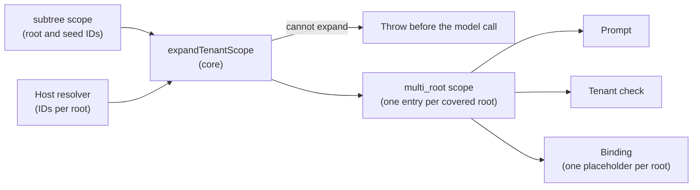

# ADR 0014: A `subtree` scope expands per root, in core

**Status:** accepted · 2026-09-29

## Decision

A `subtree` access means "these tenants and every tenant below them". AskDB never queries the database, so the host's `resolveTenantDescendants` callback returns the IDs of the subtree. It returns them per tenant root, keyed by root table ID.

Core expands the subtree into a `multi_root` scope with one entry for each root that the subtree covers. Each root's IDs bind only to that root's own placeholder. A covered root with no IDs stays in the scope with an empty list. When the subtree covers one root, the result is the equal `ids` scope.

`expandTenantScope()` is the one expansion. `ask()` runs it before generation, so the prompt, the tenant check and binding all read the per-root scope. A host runs it before a rebind, and `@askdb/client` runs it for the host. A subtree that core cannot expand fails closed before the model call.

## Why

- Each root table has its own ID space. A flat list bound to the top root's placeholder matched another tenant whose ID equalled a descendant's ID.
- The tenant check passed that SQL, because the predicate was well formed. Only the meaning of the IDs was wrong.
- A flat list has no key for the level, so core cannot tell an agency ID from a client ID.
- A `multi_root` scope already goes through the prompt, the tenant check and binding. An expanded subtree needs no special case in any of them.
- A dropped empty level was less restricted than a level with IDs, because no rule checked a read of that root.

## Options

| | Option | Why it lost |
|---|---|---|
| A | The resolver returns IDs per root, and core expands them into `multi_root` | **Chosen.** |
| B | One flat ID list, bound to the root's placeholder | It is the leak: it is correct only when every ID belongs to the scope's root table. |
| C | IDs of the scope's root only, with descendant rows reached by joins | A query on a lower level needs a join chain that the policy does not declare. The model can still pair the placeholder with a child column. |
| D | Refuse `subtree` when the root has child roots | The access kind is then unusable on the hierarchies a policy can declare, and each host builds the expansion by hand. |
| E | Accept the flat list with a warning | To accept it is the leak. |
| F | Drop a level with no IDs, and pass the covered roots to the tenant check separately | Each caller must keep a second input in step with the scope, which stops being the single description of access. |

## Keep

| Rule | Checked by |
|---|---|
| A missing resolver throws before the model call. So does a flat list, a key outside the subtree, an invalid ID list, or a result with no IDs. | `packages/core/src/ask.test.ts` |
| Core never moves an ID from one root to the placeholder of another root. | `packages/core/src/ask.test.ts` |
| The seed IDs are always in the entry of the scope's root. | `packages/core/src/ask.test.ts` |
| A covered root with no IDs stays in the scope. Under `strict`, a read of it without its own placeholder is refused, and its placeholder never binds. | `packages/core/src/ask.test.ts`, `packages/core/src/sql/rebind.test.ts` |
| Each root derives a different placeholder. A policy with two roots on one placeholder fails at load, at scope validation and at binding. | `packages/core/src/schema/v2/tenant-policy.test.ts`, `packages/core/src/ask.test.ts`, `packages/core/src/sql/tenant-placeholders.test.ts` |
| `placeholderForTenantRoot()` is the one derivation. The prompt, the tenant check and binding all use its result. | `packages/core/src/sql/tenant-placeholders.test.ts`, `packages/core/src/sql/tenant-prompt.test.ts`, `packages/core/src/ask.test.ts` |
| Core reads the resolver's result once. A value that validation did not see never binds. | `packages/core/src/ask.test.ts` |
| The prompt, binding and a rebind refuse a `subtree` scope that is not expanded. | `packages/core/src/sql/tenant-prompt.test.ts`, `packages/core/src/sql/tenant-placeholders.test.ts`, `packages/core/src/sql/rebind.test.ts` |
| When the policy has more than one root, the prompt lists under each placeholder the columns that hold that root's IDs. | `packages/core/src/sql/tenant-prompt.test.ts` |
| `@askdb/client` uses core's expansion and has none of its own. | `packages/client/src/client.test.ts` |
| A built-in expansion, such as a recursive query, must give one ID set per level. It never puts a lower level's IDs under the root. | review |
| AskDB checks that an ID is filed under a root the subtree can contain. It does not check that the ID is a descendant: authorization stays with the host. | review |

The details of the expansion are in `docs/contracts/tenant-policy.md`. The tenant check stays a lint, not a boundary (ADR 0012).
