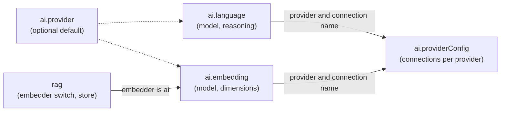

# ADR 0016: AI config: connections in `providerConfig`, the model choice in `language` and `embedding`

**Status:** accepted · 2026-10-02

## Decision

`ai.providerConfig.<provider>` holds provider connections only: a key, an endpoint, a resource, an API version. A value is one connection or a list of them. A connection's `name` defaults to `"default"` and is unique within its provider.

The model choice has one section per use: `ai.language` and `ai.embedding`. `ai.provider` is an optional default for both. A section's provider is its own `provider` or `ai.provider`. Its connection is its own `connection` or `"default"`, found within that provider. Each section receives its own connection only.

The language model has a default per provider. The embedding model has none: `rag.embedder: "ai"` requires `ai.embedding.model`, and no layer picks one. `ai.embedding.dimensions` is only a size to request from the provider. When a store needs the width first, AskDB learns it from the model.

`rag` keeps the embedder switch and the store. A section that cannot resolve fails at load. A removed key fails at load too, and the error names its replacement.

## Why

- The embedding key was in an OpenAI branch under `rag`. With another provider, Studio sent that key to the wrong provider and asked it for an OpenAI model.
- One object held a connection and a model choice. It left no place for a provider used only for embeddings, or for a second connection to one provider.
- The embedding model is part of a stored index: the embedder ID and the vector width. A default that changes makes each index built on it invalid.
- The cost: a new provider beside an explicit `model` pairs that model ID with the new provider. Config loading cannot catch this, so the first model call fails.

## Options

| | Option | Why it lost |
|---|---|---|
| A | Connections in `providerConfig`, one model section per use, an optional `ai.provider` default | **Chosen.** |
| B | Embeddings stay under `rag`, with their own provider and key | It is a second place for the same secret, and RAG keeps a provider resolution of its own. |
| C | An `embeddingModel` field in each provider branch | One choice is split across two places, and the connection and the model choice stay mixed. |
| D | No default: `provider` is required in every section | Every existing config must migrate `ai.provider`. |
| E | No default: a section's provider comes from the only connection | A second connection breaks a section that the user did not edit. |
| F | Named connections as `providerConfig` keys, each with a `provider` field | The keys stop being provider IDs, so the entries lose their per-provider types. |
| G | Connection names global across providers | The name becomes a second way to choose a provider, and it can contradict `section.provider`. |
| H | A default embedding model per provider | A changed default or a retired model invalidates each index built on it, and on Azure the model is a deployment name. |
| I | Require `dimensions` when AskDB does not know a model's width | AskDB must then keep a list of model widths. |

## Keep

| Rule | Checked by |
|---|---|
| A provider secret has one place: a connection in `ai.providerConfig`. A section receives its own connection only. | `packages/config/src/config.test.ts` |
| No layer picks an embedding model: not the config, not `@askdb/ai`, not a custom adapter. | `packages/config/src/config.test.ts`, `packages/ai/src/section.test.ts`, `packages/ai/src/provider.test.ts` |
| No layer keeps a list of model widths. A store that needs the width gets it from the model. | `packages/rag/src/embedders/dimensions.test.ts`, `packages/config/src/config.test.ts` |
| A section fails at load when it has no provider, names a connection that does not exist, or uses Anthropic for embeddings. | `packages/config/src/config.test.ts` |
| A connection name is unique within its provider. | `packages/config/src/config.test.ts` |
| A removed key fails at load. The error names the key and its replacement, never a value. | `packages/config/src/config.test.ts` |
| The keys of `ai.providerConfig` are provider IDs, custom providers included. | `packages/config/src/config.test.ts` |
