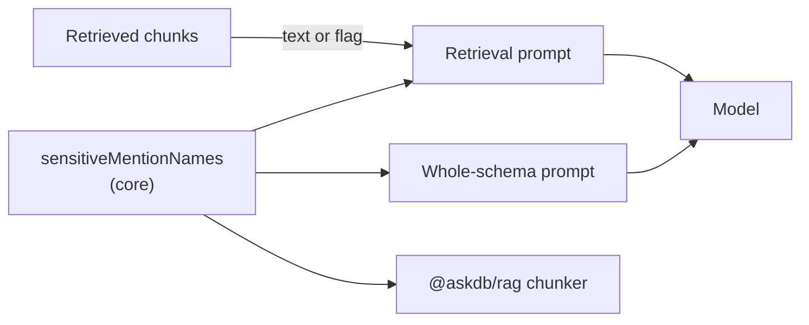

# ADR 0022: Omission withholds text that names a sensitive column

**Status:** accepted · 2026-11-05

## Decision

With omission on, both NL-to-SQL prompt builders in core check every piece of describable text they render. The whole-schema prompt and the retrieval prompt withhold text that names a sensitive column. The names come from one list in core, `sensitiveMentionNames`, which `@askdb/rag`'s chunker also imports (ADR 0017).

Text is withheld in whole units, the same units as the chunker: a description, one alias, a column's whole annotation, a common query language block. A sentence is never cut.

On the retrieval path, core trusts nothing the retriever did. It withholds a chunk when its text names a sensitive column, or when the chunk is flagged `sensitive`. A withheld chunk still selects its tables.

With omission off, nothing changes: the prompt lists sensitive names with a tag on purpose.

## Why

- Omission withheld a sensitive column's own line, but a table description such as "Stores each customer's email and phone" still reached the model.
- The retrieval prompt renders a table's text from the schema again, so the index's filter has no effect there.
- A custom retriever, an index that keeps sensitive text by option, and an old index all send chunks that name sensitive columns.

## Options

| | Option | Why it lost |
|---|---|---|
| A | Check the text and the flag, in whole units, from one name list in core | **Chosen.** |
| B | Check the text only | It misses a chunk flagged for its links, such as a concept linked to a column that is sensitive through its table. |
| C | Trust the flag only | A custom retriever and an old index send such chunks with `sensitive: false`. |
| D | Redact the name and keep the sentence | The rest of the sentence still says what the column holds, and a placeholder shows that a name was removed. |
| E | Keep the name list in `@askdb/rag` and copy it into core | Two owners of one rule drift, and that is how the prompts came to disagree with the index. |
| F | Export a matcher, not the list | The list works with both mention functions, and an authoring warning must name the column it found. |

## Keep

| Rule | Checked by |
|---|---|
| With omission on, no sensitive column name reaches the model, on the whole-schema path and the retrieval path. | `packages/core/src/ask.test.ts` |
| The retrieval prompt withholds a chunk for its text or for its `sensitive` flag. It never trusts the retriever to have filtered. | `packages/core/src/retrieval/synthesize-ddl.test.ts` |
| Text is withheld in whole units: each alias alone, and a column's annotation together. No name is redacted inside a sentence. | `packages/core/src/schema/v2/format.test.ts` |
| Core owns the one name list, and `@askdb/rag` imports it. | `packages/core/src/schema/v2/mentions.test.ts`; review |
| A withheld chunk still selects its tables, so the table definitions are the same with or without omission. | `packages/core/src/retrieval/synthesize-ddl.test.ts` |
| The counts of withheld text reach the log: the whole schema's count on the redaction event, and the retrieval prompt's count on the retrieval event. | `packages/core/src/ask.test.ts` |
| With omission off, the text stays and the count is 0. | `packages/core/src/schema/v2/format.test.ts`, `packages/core/src/retrieval/synthesize-ddl.test.ts` |

The tenant policy block is the one exception to omission (ADR 0026).
