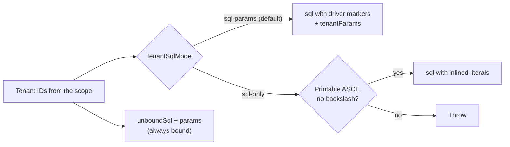

# ADR 0024: Tenant IDs are driver parameters by default

**Status:** accepted · 2026-11-05

## Decision

The default `tenantSqlMode` is `sql-params`, exported as `DEFAULT_TENANT_SQL_MODE`. Tenant IDs leave the SQL text: a host runs `sql` with `tenantParams`. `ask()` and a rebind share this default. The mode governs `sql` only: `unboundSql` always binds the tenant IDs, with the IDs in `params`.

`sql-only` is the opt-in for a tool that takes one SQL string. An inlined tenant ID must be printable ASCII (U+0020 to U+007E) with no backslash. Any other ID is refused, not escaped. Quotes are doubled, and nothing else is escaped.

AskDB chooses driver markers only for a built-in dialect. With a custom `AskDialect` and a tenant policy, the host must set `tenantSqlMode`, or `ask()` throws before any model call. A mode that is neither of the two values throws on every dialect.

## Why

- No check runs on the rendered SQL (ADR 0010), so rendering must never change the statement's structure.
- An inlined literal keeps the structure only when the server reads its bytes as the dialect does. AskDB cannot see the server's string settings or the connection charset.
- A backslash breaks out of the literal when the server reads backslash escapes. Under a Japanese connection charset, `¥` goes out as the backslash byte.
- `$1` is not a parameter marker on every engine. SQL Server reads it as a money constant, so the query runs and filters to the wrong tenant.

## Options

| | Option | Why it lost |
|---|---|---|
| A | Bind by default, and inline printable ASCII only on request | **Chosen.** |
| B | Keep `sql-only` as the default and harden it | The default path still puts tenant IDs into SQL text that no check reads. |
| C | Give a custom `AskDialect` `$N` markers by default | On SQL Server the query runs and filters to the wrong tenant. |
| D | Keep `sql-only` as the default for a custom `AskDialect` only | Two defaults are two rules to document, and one of them is the inlining this decision leaves. |
| E | Escape a backslash in a form that every server setting reads the same | MySQL and MariaDB have no such form: a hex literal changes the value's type and collation. |
| F | Refuse only the characters known to map to the backslash byte | Safety then depends on a complete list of every charset's mappings. |
| G | Keep the backslash rule and document "UTF-8 connections only" | It makes the guarantee in ADR 0012 conditional. |
| H | Detect the server's string settings and charset | Core does no database I/O, and one detected setting cannot cover every connection a host opens. |
| I | Leave `sql` out of a rebind when an ID cannot be inlined | The result's shape depends on the data, so code tested with ASCII IDs fails in production. |
| J | Refuse backslashes in business values too | It refuses legitimate values such as `C:\tmp`, and `unboundSql` with `params` already carries them safely. |
| K | Let `tenantSqlMode` also inline into `unboundSql` | A caller of `unboundSql` binds `params` anyway, so it only puts the IDs back in the SQL text. |

## Keep

| Rule | Checked by |
|---|---|
| Without `tenantSqlMode`, `ask()`, `resolveTenantSql()` and a rebind bind tenant IDs as driver parameters. Inlining never becomes the default again. | `packages/core/src/sql/tenant-placeholders.test.ts`, `packages/core/src/sql/rebind.test.ts` |
| An inlined tenant ID outside printable ASCII, or with a backslash, is refused on every dialect and with no dialect. It is never escaped. | `packages/core/src/sql/tenant-placeholders.test.ts`, `packages/core/src/sql/rebind.test.ts` |
| Such an ID still binds in `sql-params` mode. | `packages/core/src/sql/tenant-placeholders.test.ts`, `packages/core/src/sql/rebind.test.ts` |
| A custom `AskDialect` with a tenant scope and no `tenantSqlMode` throws before the dialect or the model is called. | `packages/core/src/sql/tenant-placeholders.test.ts` |
| A `tenantSqlMode` that is neither value throws. It is never read as one of the two. | `packages/core/src/sql/tenant-placeholders.test.ts`, `packages/core/src/sql/rebind.test.ts` |
| A `DialectSpec` under a built-in id keeps that engine's markers. Another id is refused as an unknown dialect (ADR 0029). | `packages/core/src/sql/tenant-placeholders.test.ts` |
| `unboundSql` binds the tenant IDs in both modes, in `ask()` and in a rebind. | `packages/core/src/ask.test.ts`, `packages/core/src/sql/checked-statement.test.ts` |
| A host that reports or forwards the mode imports `DEFAULT_TENANT_SQL_MODE`. Studio's browser copy must equal it. | `apps/studio/src/web/lib/playground-tenant.test.ts`; review |
| Docs keep the dialect-match condition for inlined business values, and the warning about drivers that interpolate parameters on the client. | review |
