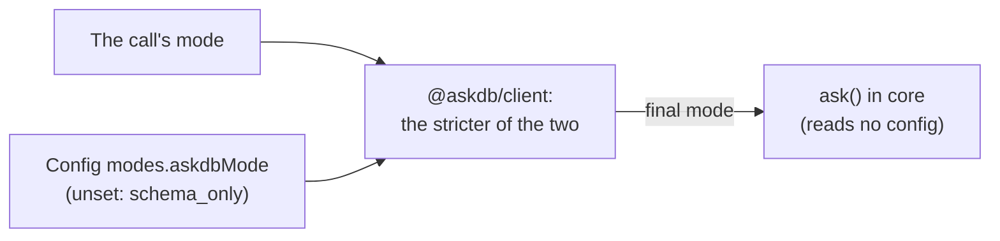

# ADR 0025: Config mode is the loosest a call gets

**Status:** accepted · 2026-11-05

## Decision

`@askdb/client` resolves the mode. It runs the stricter of the call's `mode` and the config's `modes.askdbMode`. An unset config counts as `schema_only`.

A call can tighten the mode to `schema_only`. `bounded_results` runs only when the config allows it. A call that asks for a looser mode runs at the config mode, with no error, and the log records the mode that ran.

The CLI and the HTTP API pass only the caller's mode and leave the config to the client. Each still validates its own input first. Core's `ask()` reads no config, so the `mode` its caller passes is final.

## Why

- The HTTP API reads the mode from the request, so without a floor a remote caller chooses the trust boundary.
- A floor added after 1.0 breaks callers. `bounded_results` is a reserved stub today, so the floor changes no SQL now.
- The CLI and the HTTP API each resolved the mode themselves, and the library path ignored the config.
- `modes.omitSensitiveFromPrompt` is already a floor in the client: a call can turn omission on, never off. The mode works the same way.

## Options

| | Option | Why it lost |
|---|---|---|
| A | The config mode is a floor, and a looser call runs at the config mode | **Chosen.** |
| B | The call's mode wins, and the config is only the default | An HTTP request can loosen the operator's trust boundary. |
| C | A floor only when the config sets `askdbMode` | An unset config and `schema_only` then mean different things, although the docs call `schema_only` the default. |
| D | Reject a looser request with a new error and HTTP `403` | It breaks requests that get `200` today, for a mode that changes nothing yet, and it differs from the omission floor. |
| E | Keep the resolution in each host | That made three copies, and the library path had none. |

## Keep

| Rule | Checked by |
|---|---|
| A per-call mode never loosens the config mode. An unset config counts as `schema_only`. | `packages/client/src/client.test.ts` |
| A call can tighten the config mode, in any spelling the parser accepts. | `packages/client/src/client.test.ts` |
| An unknown call mode throws. It never runs the config mode. | `packages/client/src/client.test.ts` |
| The CLI and the HTTP API pass the caller's mode to the client and do not resolve it again. | `apps/cli/src/spawn-config-modes.test.ts`, `apps/http-api/src/server.integration.test.ts`; review |
| A bad `--mode` exits 1, and a bad request mode returns `400`. | `apps/cli/src/ask.test.ts`, `apps/http-api/src/server.integration.test.ts` |
| The client's rule compares against `schema_only` only. A third mode needs an explicit order from strictest to loosest. | review |
