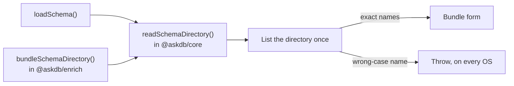

# ADR 0027: Core reads a schema directory, names exact

**Status:** accepted · 2026-11-05

## Decision

`readSchemaDirectory()` in `@askdb/core` is the one function that reads a schema directory into its bundle form. `loadSchema()` reads every directory through it, and `bundleSchemaDirectory()` in `@askdb/enrich` returns its result.

The names the loader looks up are exact: `schema.json`, `tenant-policy.md`, `concepts.md`, `tables/`, and the `.md` extension in `tables/`. An entry that matches one of them only when case is ignored throws, on every OS. One error names every rename. When both spellings exist, the error says to keep one.

A path the caller passes is read as given. An optional file is absent only when the directory listing does not have it.

## Why

- A wrong-case `Tenant-Policy.md` loaded as no tenant policy on Linux, and as the policy on macOS and Windows. A directory that worked on a laptop failed open in a Linux container.
- The bundler held its own copy of the read, and the copy drifted. An unreadable `tenant-policy.md` once gave a bundle with tenant enforcement off.
- This decision and ADR 0028 move file access for a schema directory into core. They replace the note in ADR 0004 that core stays out of filesystem work.

## Options

| | Option | Why it lost |
|---|---|---|
| A | Exact names, a wrong-case name throws on every OS, and core owns the read | **Chosen.** |
| B | Match every name in any case, and throw only when two spellings exist | Studio and `@askdb/rag` read exact names, so on Linux they would read other files than `loadSchema()` reads. |
| C | Keep two copies of the read, with the check in both | Two copies of a tenant-safety rule in two packages already drifted once. |

## Keep

| Rule | Checked by |
|---|---|
| A wrong-case schema file is never accepted and never skipped: it throws on every OS, and one error names each rename. | `packages/core/src/schema/v2/loader.test.ts` |
| When both spellings of a name exist, the error says to keep one. A rename would overwrite a file. | `packages/core/src/schema/v2/loader.test.ts` |
| "Wrong case" uses the name key of ADR 0013, so a name that the filesystem folds, such as `tableſ`, also throws. | `packages/core/src/schema/v2/loader.test.ts` |
| A listed file that cannot be read throws, and so does a symbolic link whose target is missing. | `packages/core/src/schema/v2/loader.test.ts` |
| The directory read is never copied into another package. `bundleSchemaDirectory()` refuses the directories that `loadSchema()` refuses. | `packages/enrich/src/workspace.test.ts`; review |
| A bundle from `readSchemaDirectory()` loads to the same schema as the directory. | `packages/core/src/schema/v2/loader.test.ts` |
| A new optional file goes in the one list of schema-directory files in the loader. The name check, the read, the bundle loader and the stray-JSON guard all read that list. | review |
| Other near-misses, such as `tenant_policy.md` or a `.markdown` file, are not schema files, and the loader ignores them. | review |
