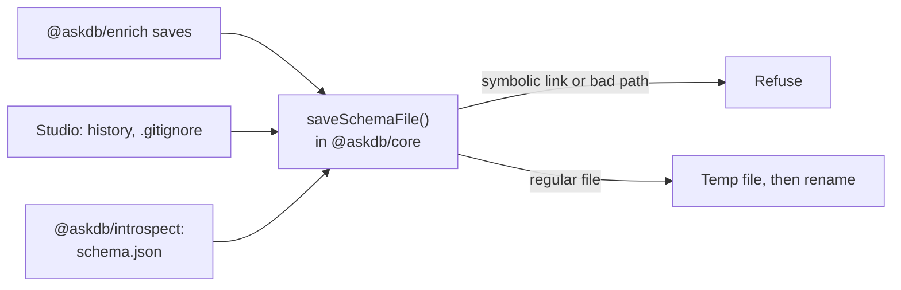

# ADR 0028: Core writes schema-directory files

**Status:** accepted · 2026-11-05

## Decision

`saveSchemaFile()` in `@askdb/core` is the one function that writes a file into a schema directory. Every writer calls it: the saves in `@askdb/enrich`, Studio's Playground history and `.gitignore` update, and the `schema.json` write in `@askdb/introspect`.

It refuses a symbolic link at the file, and at any directory between the file and the schema directory. It writes a temp file beside the target and renames it over the target. It checks the relative path itself, because callers outside AskDB pass it paths.

A change to part of a file is a read, then a save of the whole file. There is no append variant. Reads do not change: a read still follows a link, and ADR 0027 decides which files are read.

## Why

- A schema directory can come from an untrusted checkout, and git stores symbolic links. A write in place follows a link to any file the user can write.
- The writers sit in Studio, `@askdb/enrich` and `@askdb/introspect`. The only package all three share is `@askdb/core`.
- Studio's request guard (ADR 0009) limits who can start these writes, so this rule is defense in depth.

## Options

| | Option | Why it lost |
|---|---|---|
| A | Core owns the write, as a public export | **Chosen.** |
| B | Export it from `@askdb/enrich`, and make introspect depend on enrich | Every engine package depends on introspect, so each would install the authoring package to write one file. |
| C | Export it from `@askdb/enrich`, and give introspect its own copy | Two copies of a safety rule in two packages drift, and that failed open twice before. |
| D | Put it in `@askdb/introspect/kit` | Enrich would depend on introspect, and the kit holds parts for engine packages, not file writes. |

## Keep

| Rule | Checked by |
|---|---|
| A write never follows a symbolic link at the file or at a directory below the schema directory. The schema directory itself may be a link. | `packages/core/src/schema/v2/save-file.test.ts` |
| A file is never written in place: the write is a temp file, then a rename. A hard link is detached, and a failed write leaves no temp file. | `packages/core/src/schema/v2/save-file.test.ts` |
| A relative path with an empty, `.` or `..` part, or a NUL byte, is refused. So is an absolute path. | `packages/core/src/schema/v2/save-file.test.ts` |
| The new file keeps the target's permission bits and group. When the group cannot be kept, the group gets no access it did not have. | `packages/core/src/schema/v2/save-file.test.ts`, `save-file-ownership.test.ts` |
| A target the caller cannot write is refused, and the file stays unchanged. | `packages/core/src/schema/v2/save-file.test.ts` |
| Every writer of a schema-directory file calls `saveSchemaFile()`, and no package holds a second copy of the rules. The index and lock files of `@askdb/rag` are the exception: each takes a full path and is replaced by a rename. | `packages/enrich/src/workspace.test.ts`, `packages/introspect/src/introspect.test.ts`, `apps/studio/src/server.test.ts`; review for a new writer |
| In Studio, a refused history write fails the request. A refused `.gitignore` write does not, and the history still saves. | `apps/studio/src/server.test.ts` |
| Studio's `.gitignore` update keeps the bytes of the existing lines. | `apps/studio/src/server.test.ts` |

The rule does not cover a directory below the schema directory that is swapped for a link during a save. The other limits (access control lists, the rename on Windows) are in the docs site's reference for `saveSchemaFile()`.
