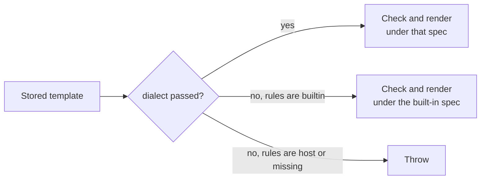

# ADR 0032: A rebind uses the host's dialect rules

**Status:** accepted · 2026-11-05

## Decision

A prepared query records which rules made it: its `dialectRules` field is `"builtin"` or `"host"`. `ask()` writes `"builtin"` only when it ran with core's own spec object for the dialect. Any other `DialectSpec` object makes it `"host"`, an unchanged spread included.

At rebind, the host passes the spec that `ask()` ran with, or a built-in id, as `dialect`. The rebind checks and renders under that spec everywhere. The spec's `id` must equal the template's dialect.

A rebind never guesses the rules. Without `dialect`, it refuses a `"host"` template and a template that has no `dialectRules`. A `"builtin"` template rebinds under the built-in spec.

## Why

- A stored template recorded only the dialect id. A rebind under the built-in spec dropped the host's escaping, its blocked functions and its extra validation.
- With the host's `backslashEscapes` dropped, a business value can end its string literal early, and the rest runs as SQL.
- AskDB cannot recover the spec from the stored template, and it cannot tell which stored templates a host's spec made.

## Options

| | Option | Why it lost |
|---|---|---|
| A | Record which rules made the template, take the host's spec at rebind, and refuse without it | **Chosen.** |
| B | Store a fingerprint of the spec's rules in the template | `extraValidate` is a function that AskDB cannot compare, and the fingerprint is more stored shape to keep stable. |
| C | Return no reuse artifacts when `ask()` runs with a spec object | It takes rebind away from the hosts that the docs tell to spread a spec. |
| D | Require `dialect` on every rebind | Every bind call changes again, and hosts on the built-in rules gain nothing. |
| E | Rebind a template that has no `dialectRules` under the built-in rules | A template stored under a host's spec keeps the hole, and AskDB cannot tell which templates those are. |

## Keep

| Rule | Checked by |
|---|---|
| A rebind never uses the built-in spec for a `"host"` template, or for a template with no valid `dialectRules`. | `packages/core/src/sql/rebind.test.ts` |
| `ask()` writes `"host"` for every spec object except core's own constant. | `packages/core/src/sql/rebind.test.ts` |
| A rebind checks and renders under the spec the host passes: its escaping and its blocked functions apply. | `packages/core/src/sql/rebind.test.ts` |
| A `dialect` whose `id` differs from the template's dialect throws. | `packages/core/src/sql/rebind.test.ts` |
| `askdb.bind()` passes `dialect` to the rebind. | `packages/client/src/client.test.ts` |
| `dialectRules` is a label, not a verdict: the rebind still checks the template again (ADR 0010). | review |
| The docs never tell a host to set `dialectRules` by hand. | review |

AskDB trusts the spec the host passes: it cannot tell whether that spec is the one `ask()` ran with. AskDB does not sign the template. A host that wants its rules applied to every template passes `dialect` on every rebind. A host that loads two copies of `@askdb/core` passes `dialect` too.
