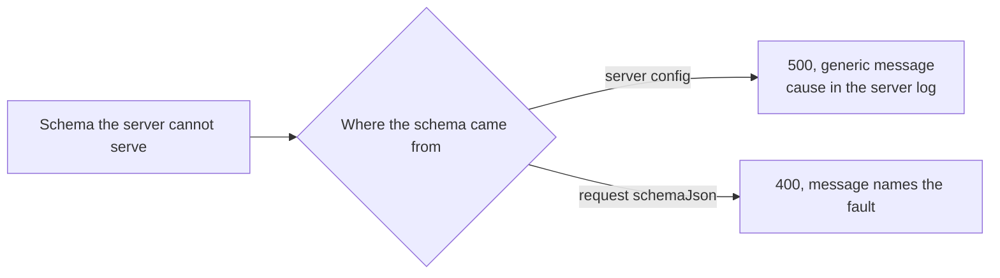

# ADR 0039: `askdb-http` refuses a schema it can't serve

**Status:** accepted · 2026-11-06

## Decision

`askdb-http` refuses a schema it cannot serve, and the status follows who can fix it. A fault in the server's own schema answers `500` with a generic message, because only the operator can fix it. A fault in a request's `schemaJson` answers `400` with a message that names the fault.

| Fault | The server's own schema | A request's `schemaJson` |
|---|---|---|
| The engine has no AskDB dialect, or the schema records no engine | `500 generation_not_configured` | `400 bad_request` |
| The schema does not load | `500 generation_not_configured` | `400 schema_parse_error` |
| No schema is configured | `500 generation_not_configured` | Does not apply |
| The schema has a tenant policy, and the server cannot pass a tenant scope | `500 tenant_scope_not_configured` | `500 tenant_scope_not_configured` |

The server never falls back to PostgreSQL for an engine it does not know. It generates and checks SQL for a request schema under that schema's own `provider`. The config's `dialect` applies to the server's own schema only.

The server log names the cause of each `500` by its error class.

## Why

- A check of one engine's SQL under another engine's rules can pass SQL that the real engine reads differently (ADR 0012).
- A `4xx` for the server's configuration blames the caller, who cannot fix it, and it can return a server path to them.
- A generic `500 internal_error` reads as a crash.
- Each new public code is one more to freeze at 1.0, and a client cannot act differently on two `500` codes.

## Options

| | Option | Why it lost |
|---|---|---|
| A | Refuse, set the status by the schema's source, reuse `generation_not_configured`, and add one code for a missing tenant scope | **Chosen.** |
| B | A new public code for each cause | A client cannot act differently on each `500`, and the log already names the cause. |
| C | `400` for every fault | It blames the caller for the server's configuration and returns the server's config hint to them. |
| D | Keep the PostgreSQL fallback and document it | It keeps checking SQL under the rules of a guessed engine. |
| E | `501` or a `4xx` for a schema with a tenant policy | `501` means an HTTP method the server does not support, and a `4xx` blames the caller. |
| F | The config's `dialect` wins over a request schema's `provider` | A server configured for `postgres` then generates and checks PostgreSQL for a schema that records `mysql`. |
| G | Refuse a request schema whose `provider` differs from the config | It bars a caller from every other engine on that server. |

## Keep

| Rule | Checked by |
|---|---|
| The server returns no SQL for a schema whose engine has no AskDB dialect. | `apps/http-api/src/server.integration.test.ts` |
| A fault in the server's own schema answers `500 generation_not_configured`. The message names no provider and no path, and the log names the cause. | `apps/http-api/src/server.integration.test.ts` |
| A fault in a request's `schemaJson` answers `400`. The message names the provider and the supported ids, and never the server's config. | `apps/http-api/src/server.integration.test.ts` |
| SQL for a request schema is generated and checked under that schema's own `provider`, not the config's `dialect`. | `apps/http-api/src/server.integration.test.ts` |
| A schema with a tenant policy answers `500 tenant_scope_not_configured` and returns no SQL. | `apps/http-api/src/server.integration.test.ts` |
| Only a missing tenant scope gets that code. Every other scope fault stays `500 internal_error`, and the message leaks no schema detail. | `apps/http-api/src/map-ask-error.test.ts` |
| Studio picks the dialect with `resolveDialect()` from `@askdb/client`, and its Playground refuses an engine with no AskDB dialect. | `apps/studio/src/server.test.ts` |
| `resolveDialect()` refuses an unknown engine unless the host asks for the PostgreSQL fallback. | `packages/client/src/dialect.test.ts` |
