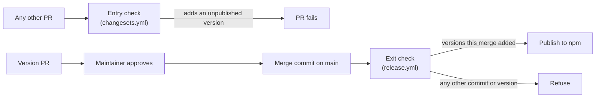

# ADR 0040: Approving the Version PR is the release approval

**Status:** accepted · 2026-11-06

## Decision

The maintainer's approval of the Version PR (`changeset-release/main`) is the release approval. After that PR merges, `release.yml` publishes to npm with no second approval.

Two checks tie what ships to what the maintainer approved. An entry check in `changesets.yml` fails any other PR that adds a public `name@version` npm does not have. An exit check in `release.yml` lets `publish` run only on the merge commit of a merged Version PR. It publishes only the versions that merge added.

An agent never approves the Version PR, even when `gh` runs with the maintainer's credentials.

## Why

- The old second approval, a required reviewer on the `npm-publish` environment, repeated the PR review. It showed no commit and no version list to judge.
- Publishing ships every public version that npm lacks, from the commit CI tested. Without the checks, a later commit can publish approved versions with its own code.
- Agents run `gh` as the maintainer, so the rule must name who approves.

## Options

| | Option | Why it lost |
|---|---|---|
| A | The Version PR review, with an entry check and an exit check | **Chosen.** |
| B | Keep the environment's required reviewer | It repeats the PR review, and it does not stop a publish from the wrong commit on purpose. |
| C | The Version PR review as the only approval, with no checks | An unpublished version that reaches `main` another way publishes with no stop, and so does an approved version built from a later commit. |
| D | Also require an approving review at publish time | It repeats the `main` ruleset and names the approver in the workflow, to close only an admin bypass merge of the Version PR. |

## Keep

| Rule | Checked by |
|---|---|
| An agent never approves the Version PR. It enables auto-merge on it, or merges it, only after the maintainer approves it. | review |
| Only the Version PR adds a public `name@version` that npm does not have. Any other PR that adds one fails, and the check fails closed when it cannot reach npm. | `scripts/check-unpublished-versions.test.mjs` |
| `publish` runs only on the merge commit of a merged `changeset-release/main` PR from this repository, and only when that merge added every version to publish. | `scripts/check-version-pr-merge.test.mjs` |
| Both checks read the public packages through `scripts/release-packages.mjs`, the module the publish list uses. | `scripts/check-unpublished-versions.test.mjs`, `scripts/check-version-pr-merge.test.mjs` |
| The exit check runs in a job of its own. The job that holds the OIDC token gets no permission to read pull requests. | review |
| The `npm-publish` environment stays, limited to `main`, with no required reviewer. Every trusted publisher names it. | review |
| A version the exit check refuses is published by hand from the merge commit of the Version PR that added it. A version no Version PR added is reverted. | review |
| A new public package's first version is published by hand from its PR branch, before the PR merges. | review |
| A change to either check, or a new publish path, needs a new ADR. | review |

`docs/release.md` holds the steps for a refused publish and for a hand publish.
