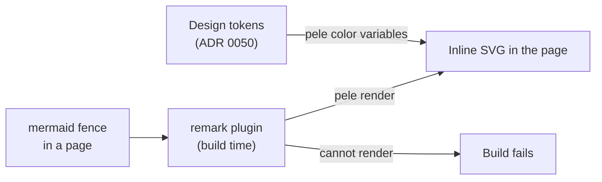

# ADR 0041: Docs diagrams with no actors are Mermaid, rendered by pele

**Status:** accepted · 2026-11-07

## Decision

A docs-site diagram with no actors is Mermaid source in a `mermaid` fence in its page. Today that is an entity-relationship diagram and a dependency graph. `apps/docs-site/plugins/remark-mermaid.mjs` renders each fence at build time with [pele](https://pele.run), as inline SVG. Pages ship no diagram JavaScript.

This ADR supersedes ADR 0034, which rendered D2 at build time. ADR 0051 owns flows and sequences. ADR 0050 owns the design tokens that color the SVG.

pele is pinned to an exact version. A diagram pele cannot render fails the build.

## Why

- D2 cost more than it saved. Each page set its diagram's width by hand, and a stand-in stylesheet mapped 36 palette classes. Its build was experimental and added about 91 MB to the install.
- pele runs in Node with no dependencies and no install script. CI needs no binary and no browser.
- pele writes no `<style>` element and reads its colors from CSS variables. One render follows the theme toggle.
- Mermaid syntax is more widely known than D2, and GitHub renders it.

## Options

| | Option | Why it lost |
|---|---|---|
| A | Mermaid, rendered at build time by pele through a remark plugin | **Chosen.** |
| B | Keep D2 (ADR 0034) | Hand sizing, a stand-in stylesheet, an experimental build and a 91 MB install cost more than D2 saved. |
| C | `rehype-mermaid` or `mmdc`, which run Mermaid in a browser | Every CI job would install Chromium, or run an install script that `allowBuilds` blocks. |
| D | Mermaid or pele's `mount()` in the reader's browser | It ships a script of about 700 KB or more for a picture that does not change. |
| E | `beautiful-mermaid` | Every SVG it writes imports Google Fonts. |

## Keep

| Rule | Checked by |
|---|---|
| Each `mermaid` fence becomes inline SVG at build time. Pages ship no diagram JavaScript. | `apps/docs-site/plugins/remark-mermaid.test.mjs` |
| A diagram pele cannot render fails the build, with the page, the line and pele's error code. | `apps/docs-site/plugins/remark-mermaid.test.mjs` |
| The plugin's font stacks equal `--sl-font` and `--sl-font-mono` in `src/styles/tokens.css`. | `apps/docs-site/plugins/remark-mermaid.test.mjs` |
| No diagram tool needs a binary or a browser in CI, runs an install script, or loads a font from another host. | review |
| pele stays pinned to an exact version that was at least two weeks old when chosen. | review |
| A pele bump rebuilds the site and checks each diagram in both themes, at desktop width and at 390 px. | review |
| Authors set no color in a diagram's source. The pele color variables map to the design tokens, so a diagram follows the theme toggle. | review |
| The `<figcaption>` is the diagram's text alternative: the SVG has no accessible name of its own. | review |
| The docs site keeps `@emnapi/runtime` at 1.x, so `astro check` loads with Astro's bundler. | review |

`apps/docs-site/STYLE.md` ("Diagrams") holds the rules for authors.
