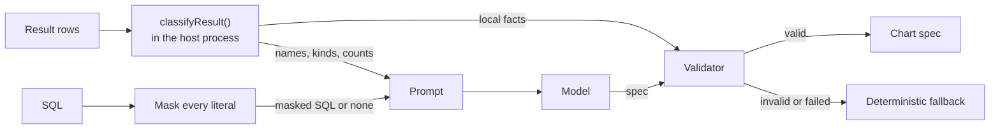

# ADR 0044: Chart planning sends no rows and no SQL literals

**Status:** accepted · 2026-11-08

## Decision

`@askdb/client/charts` asks a model to pick a chart for a query result. The model sees the question, the column names and kinds, the row count, the truncated flag and the SQL with every literal masked. It sees no row value and no SQL literal. When the planner cannot mask the SQL safely, it sends no SQL.

The model returns a declarative spec, not chart code. A validator checks every spec against the result. A chart never fails the report: on any failure the planner returns a deterministic pick, marked as a fallback with its reason.

Omission is a floor here too (ADR 0026). The subpath is experimental (ADR 0030): a minor release of `@askdb/client` may change it.

## Why

- A model that sees rows needs consent, projection of sensitive columns, and row and byte budgets. None of that is built.
- A chart needs intent and column kinds, not values. The SQL shows grouping and ordering, but its literals hold values and bound tenant IDs.
- Chart planning is not checked SQL, so it stays out of core's frozen exports. The client already has `ai` and `@askdb/core` as peers.

## Options

Where the planner lives:

| | Option | Why it lost |
|---|---|---|
| A | An experimental subpath of `@askdb/client` | **Chosen.** |
| B | A new 0.x package | One more package to publish, smoke-test and document, for about 500 lines. |
| C | In `@askdb/core` | Core's exports freeze at 1.0, and chart planning is not checked SQL. |

What the model sees of the SQL:

| | Option | Why it lost |
|---|---|---|
| A | The SQL with every literal masked | **Chosen.** |
| B | The SQL as `ask()` returned it | Its literals hold values, and its bound form holds tenant IDs. |
| C | No SQL | The model loses the grouping, ordering and aggregation that tell a ranking from a breakdown. |

What the model returns:

| | Option | Why it lost |
|---|---|---|
| A | A declarative spec, as structured output against a JSON schema | **Chosen.** |
| B | Chart code, such as Vega-Lite or a component | It is code to run, with fields to check inside it. |

## Keep

| Rule | Checked by |
|---|---|
| No row value and no SQL literal appears in the prompt the model receives. | `packages/client/src/charts/plan.test.ts` |
| The planner sends the masked SQL, or no SQL when a token never ends or a literal survives a second read. | `packages/client/src/charts/plan.test.ts`, `packages/core/src/sql/mask-literals.test.ts` |
| Masking reads SQL under the dialect's own reading for a built-in engine, and under every engine's reading for any other dialect or none. | `packages/core/src/sql/mask-literals.test.ts` |
| A result column name that holds a literal is shown under a neutral label, and the planner maps the model's answer back. | `packages/client/src/charts/plan.test.ts` |
| With omission on, the prompt carries no SQL that mentions a sensitive column, and a column named like one gets a neutral label. | `packages/client/src/charts/plan.test.ts` |
| What the classifier learns from row values stays out of the shape the prompt reads. | `packages/client/src/charts/classify.test.ts` |
| Every spec passes the validator before the planner returns it as the model's. | `packages/client/src/charts/validate.test.ts`, `plan.test.ts` |
| On a timeout, an abort, a model error or an invalid spec, the planner returns the fallback with its reason. It never rejects. | `packages/client/src/charts/plan.test.ts` |
| `packages/client/src/charts/` imports only its own files, `ai` and `@askdb/core`. Nothing else in the client imports it. | `packages/client/src/public-api.test.ts` |
| The planner reads no config and no `mode`. The host passes the omission setting, as it passes it to `ask()`. | review |
| Result summaries, which send rows, wait for the consent model of `bounded_results` (ADR 0030). Nothing in the subpath sends a row. | review |
