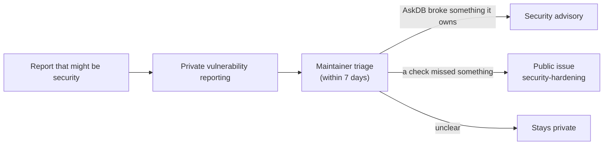

# ADR 0046: A vulnerability is a break in something AskDB owns

**Status:** accepted · 2026-11-11

## Decision

| Report | What it is | What happens |
|---|---|---|
| AskDB breaks something it owns, in a host that follows `SECURITY.md`'s "What integrators should do" | A vulnerability | A GitHub security advisory |
| SQL gets past the read-only, tenant or sensitive check | A hardening bug | A public issue labelled `security-hardening`, fixed in a normal release |

AskDB owns these things:

- code execution;
- tenant-scope validation, and the tenant IDs it binds or inlines;
- secrets;
- access control on its own local servers, the HTTP API and Studio (ADR 0009);
- package publishing and the dependency supply chain.

Every report that might be security goes through private vulnerability reporting, check misses included. Within 7 days the maintainers open an advisory, or move the report to a public issue and tell the reporter.

The rule applies to reports received from 2026-11-11 on. The 12 advisories published before that date keep their text and severity.

## Why

- The checks are a lint, and the database is the tenant boundary (ADR 0012). Under database tenant enforcement, no check miss reaches another tenant's rows.
- An advisory for each tenant-check miss made the advisory stream describe the check as a boundary. It also made `SECURITY.md` contradict itself.
- A reporter cannot always tell a check miss from a break in ID binding. Private first fails closed.
- A public fix can take the shape the code needs, not the smallest change a private fork can carry.

## Options

| | Option | Why it lost |
|---|---|---|
| A | A vulnerability is a break in something AskDB owns, and private reporting is the front door | **Chosen.** |
| B | Keep an advisory for a tenant-check miss that would read another tenant's rows | `SECURITY.md` keeps contradicting itself, and the advisory stream describes the tenant check as a boundary. |
| C | Check misses go straight to public issues | A report filed on the wrong side is public before a fix. |
| D | Keep the past advisories cited on every docs-site page | Each citation names a build that no 1.0 reader runs. |

## Keep

| Rule | Checked by |
|---|---|
| A report gets an advisory only when AskDB itself breaks something it owns. | review |
| A break in ID binding gets an advisory even where row-level security would stop the leak. | review |
| A check miss is a public `security-hardening` issue, even when it would let a tenant-scoped query read another tenant's rows. | review |
| A dialect whose string settings do not match the server is neither an advisory nor a hardening bug, unless it defeats ID binding. | review |
| Nothing goes public before triage. A report whose side is unclear stays private until the maintainers decide. | review |
| The maintainers triage a private report within 7 days and tell the reporter. | review |
| The 12 advisories published before 2026-11-11 keep their text and severity. | review |
| `SECURITY.md` and the docs site's upgrade notes keep the record of past advisories. Other docs-site pages describe current behavior and cite none. | review |
| A GitHub Release lists advisories under "Security" and `security-hardening` fixes under a separate "Security hardening" heading. | review |
| `SECURITY.md` states this rule for reporters, and `docs/agents/security-triage.md` states it for agents. A change to one changes the other. | review |

A `security-hardening` fix raises no Dependabot or advisory alert. Hosts learn of it from the "Security hardening" heading in each Release.
