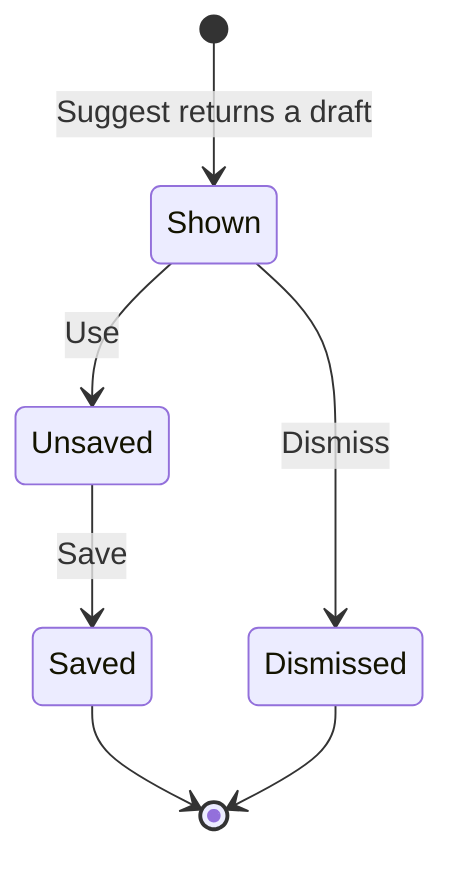

# ADR 0047: Studio Suggest drafts inline

**Status:** accepted · 2026-11-14

## Decision

Studio shows each **Suggest** draft inline, under the field it belongs to, with **Use** and **Dismiss**. Several fields can hold drafts at once. **Use** fills the unsaved draft of the table. Nothing reaches the schema artifact until **Save**.

**Suggest all empty fields** drafts every empty description and alias of the open table and its columns. It costs one model call for each field. It states the number of calls and the sensitive columns it skips, and it runs only after the author confirms.

With `modes.omitSensitiveFromPrompt` on, Studio sends no column that the saved artifact or the unsaved draft marks sensitive.

## Why

- One modal dialog for one field took five or more trips for a table with five columns. It covered the column and hid the other drafts.
- Each draft is one model call. The author must see the cost of a bulk run before it starts.
- The author confirms every draft before it lands in the artifact.

## Options

| | Option | Why it lost |
|---|---|---|
| A | Inline drafts, plus "Suggest all empty fields" for the open table | **Chosen.** |
| B | Inline drafts only, one field at a time | A table still takes one click for each field. |
| C | Keep the dialog | It is the friction that authors reported. |

## Keep

| Rule | Checked by |
|---|---|
| "Suggest all empty fields" states the number of model calls and runs only after the author confirms. | `e2e/studio/tables.spec.ts` |
| A bulk run plans one model call for each empty description and alias, and none for a filled field. It does not cover the primary entity or common query language. | `apps/studio/src/web/lib/suggest-all.test.ts` |
| A draft reaches the artifact only through **Use** and then **Save**. | review |
| With omission on, a bulk run skips each sensitive column and states how many it skips. | `apps/studio/src/web/lib/suggest-all.test.ts` |
| Suggest on a table waits for **Save** while the unsaved draft marks the table or a column sensitive and the saved artifact does not. | `apps/studio/src/web/lib/suggest-all.test.ts` |
| The server's refusal of a sensitive column stays the guard. The browser's skip only saves the call. | `apps/studio/src/server.test.ts` |
| The workspace response tells the browser whether omission is on. | `apps/studio/src/server.test.ts` |
| A bulk run makes its calls one at a time. There is no batch endpoint. | review |
