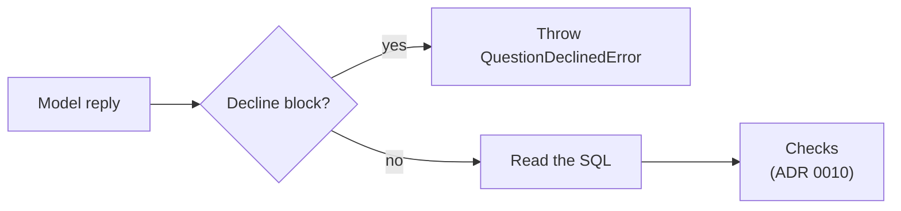

# ADR 0048: A declined question throws

**Status:** accepted · 2026-11-14

## Decision

The NL→SQL prompts give the model one way to decline: an `askdb-decline` fenced block with a one-line reason. The model declines when the schema cannot answer the question, or when the question asks to change data. A question that mixes a read with a change is declined as a whole.

AskDB reads the decline before any SQL and throws `QuestionDeclinedError` with the reason. `ask()` returns SQL or throws. No result field carries a decline.

`extractSqlFromModelText()`, the public extractor, throws the same error. A host that builds its own model call from `buildNlToSqlUserPrompt()` gets the decline too.

## Why

- The prompts demanded exactly one `SELECT`, so the model had no way to decline. An unanswerable question came back as an unrelated `SELECT`.
- A thrown error fails closed. A caller that reads `result.sql` and does not know about declines runs nothing by accident.
- The CLI, the HTTP API and Studio already map typed errors.

## Options

| | Option | Why it lost |
|---|---|---|
| A | A typed decline: a fixed marker in the reply, and a thrown error | **Chosen.** |
| B | A refusal field on the result, with no `sql` | Every caller that reads `result.sql` must check a new field first, or it runs nothing by accident. |
| C | A warning beside the closest `SELECT` | A demo still shows a confident, unrelated answer. |
| D | Prompt only: the model declines in prose | A prose decline still comes back as a lexer error. |

## Keep

| Rule | Checked by |
|---|---|
| A reply with a decline block throws `QuestionDeclinedError`, even beside a `sql` fence. AskDB never returns SQL for it. | `packages/core/src/sql/extract-sql.test.ts`, `generate.test.ts` |
| The decline is read before any check runs, and a mixed question is declined as a whole. | `packages/core/src/sql/generate.test.ts` |
| A reply cut off inside the decline block is still a decline. | `packages/core/src/sql/generate.test.ts` |
| Both prompts tell the model how to decline, and keep the one-`SELECT` rule for answerable questions. | `packages/core/src/sql/generate.test.ts` |
| A prose reply with no SQL fence is reported as "the model returned no SQL", not as a lexer error. An unfenced write statement is still checked as SQL. | `packages/core/src/sql/generate.test.ts` |
| The decline stays a thrown error. It does not move to a field on the result. | review |
| The CLI prints the reason with no SQL and exits `1`. | `apps/cli/src/ask.test.ts` |
| The HTTP API answers `422 question_declined` with the reason. | `apps/http-api/src/server.integration.test.ts` |
| Studio answers `422` with the reason and no SQL. | `apps/studio/src/server.test.ts` |
| A custom `AskDialect` that lets its model decline throws `QuestionDeclinedError` itself, or calls `extractSqlFromModelText()`. | review |

A decline produces no SQL, so the checks have nothing to rule on. ADR 0010's decision point still owns every verdict on SQL the model returns.
