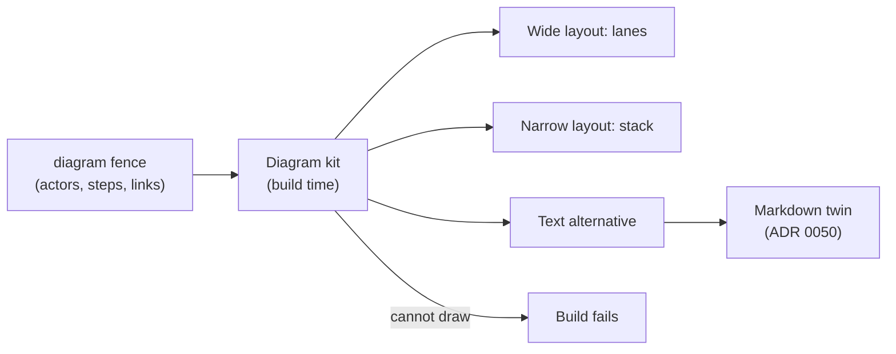

# ADR 0051: Docs flows and sequences are drawn from a `diagram` fence

**Status:** accepted · 2026-11-15

## Decision

A flow or a sequence on the docs site is a `diagram` fence. AskDB's own kit (`apps/docs-site/plugins/remark-diagram.mjs` and `plugins/diagram/`) parses and draws it at build time. The source declares actors as lanes, steps, groups, boundaries and labelled links. It holds no coordinate, no size and no color.

Ownership is the grammar. Each actor has a lane, an icon and a place. Only AskDB's lane carries the brand mark and the accent color.

The kit draws two layouts from one source: lanes side by side, and a stack of steps for a narrow column. Each diagram carries a text alternative for screen readers and for the page's Markdown twin (ADR 0050).

Diagrams with no actors stay Mermaid (ADR 0041). The home page's hero stays a hand-drawn SVG.

## Why

- Almost every diagram makes one point: who holds what. A generic flowchart draws every actor as the same box, so the point lives only in the labels.
- A stylesheet cannot give an actor an icon or a lane, or lay a diagram out a second way for a phone.
- A hand-drawn SVG holds coordinates. An agent that edits a page cannot safely move a box.

## Options

| | Option | Why it lost |
|---|---|---|
| A | A diagram kit of AskDB's own, with a declarative source | **Chosen.** |
| B | Restyle pele's output | A stylesheet cannot give an actor an icon or a lane, or a second layout for a phone. |
| C | Hand-draw each diagram as its own SVG component | Each drawing holds coordinates, so each is redrawn when a step changes, and an agent cannot safely edit one. |
| D | Draw the diagrams with no actors in lanes too | They are standard notations, and lanes would say something false about them. |

## Keep

| Rule | Checked by |
|---|---|
| A diagram's source holds no coordinate, no size and no color. | review |
| A diagram the kit cannot draw fails the build, with the page, the line and the reason. | `apps/docs-site/plugins/remark-diagram.test.mjs` |
| A flow has four lanes at most, and a sequence five. | `apps/docs-site/plugins/remark-diagram.test.mjs` |
| The kit draws a wide and a narrow layout from one source. A sequence of five actors fits a phone's width without shrinking. | `apps/docs-site/plugins/remark-diagram.test.mjs` |
| No line of text in either layout is wider than its box, and no label drops a word. | `apps/docs-site/plugins/remark-diagram.test.mjs` |
| Each diagram has a required title as its accessible name, and a text alternative that names each step's owner and where it leads. | `apps/docs-site/plugins/remark-diagram.test.mjs` |
| The page's Markdown twin prints the text alternative and the caption in place of the picture. | `apps/docs-site/src/utils/html-to-markdown.test.mjs` |
| The kit's width table matches the first font families of `--sl-font` and `--sl-font-mono` in `tokens.css`. | `apps/docs-site/plugins/remark-diagram.test.mjs` |
| A font change in `tokens.css` needs the width table checked against a browser. | review |
| Only AskDB's lane carries the brand mark and the accent color. | review |
| Pages ship no diagram JavaScript, and no text is drawn under 11 px. | review |
| A diagram with no actors stays Mermaid, and is never forced into lanes. | review |

`apps/docs-site/STYLE.md` ("Diagrams") is the authoring reference.
